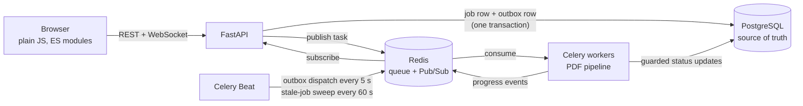
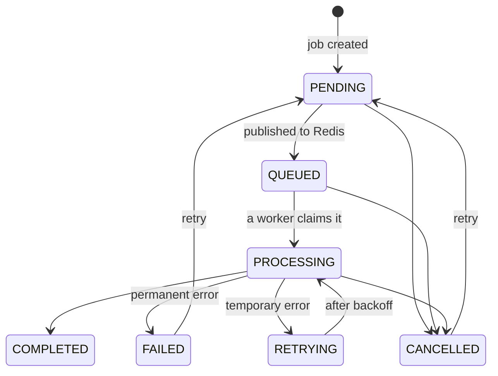

# Docket: a distributed job processing platform

Upload a PDF and get back a summary, document statistics and a generated report. The heavy work runs in background workers, so the API answers in milliseconds, and the browser follows each job live over a WebSocket.

Built from scratch as a production-style backend: **FastAPI, PostgreSQL, Redis, Celery and WebSockets**, with a small dependency-free web frontend served by the API itself.


## Why this project exists

Reading a 200-page PDF, extracting its text, summarizing it and building a report takes seconds to minutes. Doing that inside an HTTP request causes timeouts, blocks the server, loses work on a crash, and leaves the user staring at a spinner.

Docket separates **accepting work** from **doing work**:

1. The API validates the upload, saves a job and replies at once with a job ID.
2. Independent Celery workers pick the job up from a Redis queue and process it.
3. Every step is recorded in PostgreSQL, and progress is pushed to the browser as it happens.

The interesting part is not the PDF processing. It is everything needed to make that pipeline **correct when things go wrong**: broker outages, crashed workers, duplicate messages, temporary errors and cancellations.

## What it demonstrates

| Area | What is implemented |
| --- | --- |
| **Reliable messaging** | Transactional outbox: a job and its "publish this" intent are saved in one database transaction, so a crash or a Redis outage can never lose a job |
| **Fault tolerance** | Bounded retries with exponential backoff and jitter for temporary errors only, a recovery sweep that re-queues jobs whose worker died, task time limits |
| **Idempotency** | Atomic claim (`UPDATE ... WHERE status IN (...)`) so duplicate deliveries do nothing. Output files are keyed by job ID and written atomically |
| **Concurrency control** | A partial unique index lets PostgreSQL itself guarantee one active job per document, even under racing requests |
| **Real-time delivery** | WebSocket per job, fed by Redis Pub/Sub. Subscribe first, then send a database snapshot, so reconnecting clients never miss a state change |
| **Security** | Argon2 password hashing, JWT with revocable tokens (Redis denylist), per-user data isolation, layered upload validation, strict Content-Security-Policy |
| **Data design** | SQLAlchemy 2.0 typed models, Alembic migrations, JSONB results, composite and partial indexes |
| **Testing** | Unit and integration tests against real PostgreSQL and Redis (separate test database), including worker retries, crash recovery and WebSockets |
| **Frontend craft** | No framework and no build step: ES modules, a hash router, accessible components, and no `innerHTML` anywhere (enforced by a test) |

## Architecture



**PostgreSQL is the source of truth. Redis messages are only delivery hints.** If an event is lost, the next snapshot from the database corrects the client.

### Job lifecycle



### The processing pipeline

Each file goes through seven stages, reported live as `stage` and `progress`:

1. Validate the document
2. Read its metadata
3. Extract the text page by page (PyMuPDF)
4. Clean the text (ligatures, hyphenation, whitespace)
5. Generate an extractive summary and keywords (local algorithm, no paid API)
6. Build a PDF report (ReportLab)
7. Save the results atomically

## How it handles failure

| What goes wrong | What happens |
| --- | --- |
| The API crashes after saving a job but before queueing it | The job's outbox row is still in PostgreSQL. A poller delivers it later |
| Redis is down when a job is created | The API still answers `202`. The job waits as `PENDING` and is delivered when Redis returns |
| A worker hits a temporary error (database blip, disk error) | Retried with exponential backoff and jitter, up to a limit, then failed with a clear message |
| The file is corrupt or has no text | Failed immediately. Retrying a bad file would be wasted work |
| A worker is killed mid-job | The heartbeat goes stale. The recovery sweep re-queues the job, or fails it once the retry budget is spent |
| The same message is delivered twice | Only one worker can claim the job. The other skips it |
| Two requests start a job for the same document at once | The database's partial unique index rejects the second one |
| A user cancels a running job | The worker notices at its next progress update, stops, and removes partial output |
| A task runs too long | A soft time limit fails the job cleanly. A hard limit kills the process and the recovery sweep takes over |
| The WebSocket drops | The browser reconnects with backoff, and the server's first message is a fresh snapshot. Meanwhile the page polls |

Delivery is **at-least-once**, and execution is made **idempotent**, instead of pretending exactly-once delivery exists.

## Security

- **Passwords:** hashed with Argon2id (`pwdlib`). Login takes the same time for unknown and known emails, and returns the same message, so accounts can't be enumerated.
- **Tokens:** short-lived JWTs with a unique ID. Logout puts that ID on a Redis denylist that expires with the token. If Redis is unreachable, authentication fails closed.
- **Isolation:** every query is scoped to the current user. Another user's document or job returns `404`, never `403`, so IDs can't be probed.
- **Uploads:** extension, declared type, `%PDF-` signature, a real parse with PyMuPDF, a streamed size limit, generated file names, and cleanup of partial files on any failure.
- **WebSockets:** the token is sent as the first message, never in the URL (URLs end up in logs), with an authentication timeout, an expiry check on long connections and a per-user connection cap.
- **Browser:** a strict Content-Security-Policy (no inline script or style), `nosniff`, `X-Frame-Options`, a referrer policy, and `no-store` on every API response. A test fails if anyone introduces `innerHTML`, `eval` or an inline script.
- **Errors:** users only ever see generic messages for unexpected failures. Tracebacks stay in the logs.

## Tech stack

| Layer | Technology |
| --- | --- |
| API | FastAPI, Pydantic, Uvicorn |
| Database | PostgreSQL 16, SQLAlchemy 2.0, Alembic |
| Queue and events | Redis 7, Celery (worker and Beat) |
| Real time | WebSockets, Redis Pub/Sub |
| PDF processing | PyMuPDF, ReportLab |
| Auth | PyJWT, Argon2 (pwdlib) |
| Frontend | HTML, CSS and JavaScript (ES modules), served by FastAPI |
| Tooling | uv, Docker Compose, Pytest, Ruff, python-decouple |

## Getting started

**Requirements:** Python 3.12, [uv](https://docs.astral.sh/uv/), Docker, and Git. Commands below are for PowerShell. On Linux or macOS the same commands work in a shell.

```powershell
git clone https://github.com/kushbharti/distributed-job-platform.git
cd distributed-job-platform

# 1. Install dependencies
uv sync

# 2. Configure the environment
Copy-Item .env.example .env
uv run python -c "import secrets; print(secrets.token_urlsafe(48))"   # paste this as SECRET_KEY in .env

# 3. Start PostgreSQL and Redis
docker compose up -d

# 4. Create the database schema
uv run alembic upgrade head
```

Then start the three application processes, either with the helper script (Git Bash, Linux, macOS):

```bash
bash dev.sh
```

or by hand, in three terminals:

```powershell
uv run uvicorn app.main:app --reload
uv run celery -A app.tasks.celery_app:celery_app worker --loglevel=info --pool=solo   # drop --pool=solo on Linux and macOS
uv run celery -A app.tasks.celery_app:celery_app beat --loglevel=info
```

Open **http://127.0.0.1:8000**, create an account, upload a PDF and press **Process**. Interactive API docs are at `/docs`.

> If port 5432 or 6379 is already in use on your machine, change `POSTGRES_PORT` or `REDIS_PORT` and the matching URLs in `.env`.

### Configuration

All settings come from environment variables (see `.env.example`).

| Variable | Purpose | Default |
| --- | --- | --- |
| `SECRET_KEY` | Signs JWTs. Required | none |
| `DATABASE_URL` | PostgreSQL connection | none |
| `REDIS_URL`, `CELERY_BROKER_URL`, `CELERY_RESULT_BACKEND` | Redis databases for the app, the queue and task results | none |
| `ACCESS_TOKEN_EXPIRE_MINUTES` | Token lifetime | `30` |
| `MAX_UPLOAD_SIZE_MB` | Upload size limit | `20` |
| `JOB_MAX_RETRIES` | Retries for temporary errors | `3` |
| `STALE_JOB_MINUTES` | Silence before a job is considered abandoned | `15` |
| `TASK_SOFT_TIME_LIMIT_SECONDS`, `TASK_TIME_LIMIT_SECONDS` | Task time limits | `540`, `600` |
| `DEV_STAGE_DELAY_SECONDS` | Slows each stage down so progress is easy to watch (development only) | `0` |

## Running the tests

```powershell
docker compose up -d
uv run pytest
uv run pytest --cov=app --cov-report=term-missing
```

The suite runs against **real PostgreSQL and Redis**, not mocks:

- The schema is built with the project's own Alembic migrations, so the tests also prove the migrations work.
- It uses a separate database (`job_platform_test`, created automatically) and Redis DBs 13 to 15. Safety checks stop the suite if it is ever pointed at anything else.
- Worker tasks run through Celery's `apply()`, so the real task code, including retries, is exercised without a worker process.

Covered: authentication and token revocation, data isolation between users, every upload rejection path, job creation and cancellation, the outbox during a broker outage, worker success, permanent failure, bounded retries, duplicate delivery, cancellation mid-run, stale-job recovery, WebSocket authentication and events, and static-site safety rules.

## API overview

All endpoints live under `/api/v1`. Full schemas are in the interactive docs at `/docs`.

| Method | Endpoint | Purpose |
| --- | --- | --- |
| POST | `/auth/register` | Create an account |
| POST | `/auth/login` | Get an access token |
| POST | `/auth/logout` | Revoke the current token |
| GET | `/auth/me` | Current user |
| POST | `/documents/upload` | Upload a PDF |
| GET | `/documents` | List documents (paginated, with each one's latest job) |
| DELETE | `/documents/{id}` | Delete a document and its results |
| POST | `/jobs` | Start processing a document |
| GET | `/jobs` | List jobs (filter by status, paginated) |
| GET | `/jobs/stats` | Job counts per status |
| GET | `/jobs/{id}` | Job status, stage and progress |
| POST | `/jobs/{id}/cancel` | Cancel an active job |
| POST | `/jobs/{id}/retry` | Re-run a failed or cancelled job |
| GET | `/jobs/{id}/result` | Summary, keywords, statistics, metadata |
| GET | `/jobs/{id}/result/report` | Download the generated PDF report |
| GET | `/jobs/{id}/result/text` | Download the extracted text |
| WS | `/ws/jobs/{id}` | Live progress (token sent as the first message) |
| GET | `/health`, `/ready` | Liveness, and readiness (database and Redis) |

## Project structure

```
app/
├── api/v1/endpoints/   HTTP and WebSocket routes (thin: validate, call a service, respond)
├── core/               settings, security helpers, Redis client, HTTP security headers
├── db/                 engine, sessions, naming conventions
├── models/             SQLAlchemy models: User, Document, Job, JobResult, OutboxEvent
├── schemas/            Pydantic request and response models
├── services/           business logic: auth, documents, jobs, outbox, recovery, PDF pipeline
├── tasks/              Celery app, the processing task, periodic maintenance tasks
├── websocket/          event publishing and connection limits
└── static/             the web frontend (HTML, CSS, ES modules)
alembic/                database migrations
tests/                  unit and integration tests
scripts/                sample PDF and icon generators
```

Routes never contain business rules. Services do not know about HTTP. The pipeline does not know how progress is reported. Each of those boundaries is what made the later stages (retries, WebSockets) additions instead of rewrites.

## Design decisions

| Decision | Reason |
| --- | --- |
| **Modular monolith plus workers**, not microservices | Clear boundaries without the operational cost of distributed deployment |
| **Synchronous SQLAlchemy** | Celery workers are synchronous, so one consistent style serves both API and workers. FastAPI runs the blocking endpoints in its thread pool |
| **Job ID is the Celery task ID** | No mapping to maintain, and a worker can start before the API has finished recording the job |
| **Guarded `UPDATE`s instead of locks** | Every state change names the states it is allowed to come from. Concurrent actors cannot corrupt a job, and nothing holds a lock during slow work |
| **Results as files, metadata in PostgreSQL** | Large text and reports stay out of the database. Paths are stored relative, so moving to object storage later does not change the schema |
| **Extractive summarizer** | Works offline with no API key or cost. The `summarize()` function can later be swapped for an LLM provider |
| **No frontend framework** | The project is about the backend. The UI is small enough that ES modules, a 60-line router and a tiny DOM helper are enough |
| **Hash-based routing** | The server needs no catch-all route, and a refresh on any page always works |

## Limitations and next steps

Honest about what is not done:

- **Containerized deployment.** PostgreSQL and Redis run in Docker Compose. Packaging the API, workers and Beat as containers (where Celery's process pool and the task time limits apply) is the next step.
- **Observability.** Logging is plain text for now. Structured JSON logs, request IDs that follow a job from the API into the worker, and a Flower dashboard are planned.
- **Scanned PDFs** have no text layer and fail with a clear message. OCR would be an optional extension.
- **The summarizer is English-focused** and only selects existing sentences.
- **Report fonts** cover Western European scripts only.
- **The WebSocket connection cap is per API process.** Running several processes would need a shared counter.
- **Sessions** are stored per browser tab (`sessionStorage`), a deliberate trade-off against cookie-based auth for this scope.

## Author

**Kush Kumar Bharti**: backend developer (Python, Django, FastAPI), BE Information Technology student.

- GitHub: [github.com/kushbharti](https://github.com/kushbharti)
- LinkedIn: [linkedin.com/in/kushbharti](https://linkedin.com/in/kushbharti)
- Email: try.kushbharti@gmail.com
